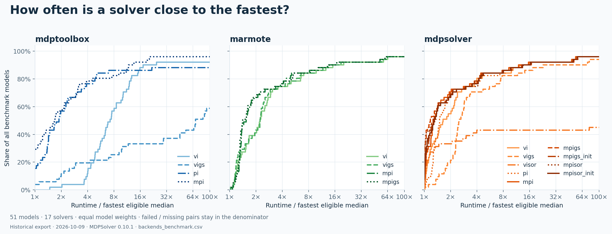

<h1 align="center">mdpforge</h1>

<p align="center"><strong>Benchmark finite MDPs. Compare solvers at a shared accuracy.</strong></p>

<p align="center">Use the catalogue or bring your own models and solvers.</p>

<p align="center">
  <a href="https://github.com/OrsoF/mdpforge/actions/workflows/ci.yml"></a>
  <a href="pyproject.toml"></a>
  <a href="LICENSE"></a>
</p>

<p align="center">
  <a href="#quick-start">Quick start</a> · <a href="#models-and-solvers">Models &amp; solvers</a> · <a href="#visualizations">Visualizations</a> · <a href="#examples-and-documentation">Documentation</a> · <a href="#contributing">Contributing</a>
</p>


*A saved comparison at discount 0.99 and target value error 0.001. Points show paired trial speedups against VI; bars show the observed minimum and maximum. These small instances illustrate the workflow; timings depend on hardware. See the [plotting notebook](notebooks/visualize_results.ipynb) for the method.*

| Extensible catalogue | Accuracy checks | Reproducible experiments |
| :--- | :--- | :--- |
| Built-in models and solvers, or your own matrices and callables. | Runtime and an independently checked value-error bound for each trial. | Export settings, seeds, matrix fingerprints, versions and machine information. |

## Quick start

### Install

Requires **Python 3.11+** and supports finite discounted problems with `0 < discount < 1`.

```sh
python -m pip install "mdpforge @ git+https://github.com/OrsoF/mdpforge.git"
```

For tables and plots, install the `notebooks` extra:

```sh
python -m pip install "mdpforge[notebooks] @ git+https://github.com/OrsoF/mdpforge.git"
```

### Run a benchmark

```python
from mdpforge import Benchmark

bench = Benchmark(default_solvers=False)
bench.add_mdp("rooms")
bench.add_solver("mdpforge_vi")
bench.add_solver("mdpforge_mpi")

result = bench.run(discount=0.9, precision=1e-3, repeats=3, seed=0)
result.export_csv("results.csv")
```

Each trial records runtime, status and an independently checked value-error bound. The CSV export includes an experiment manifest with settings, seeds, matrix fingerprints, versions and machine information.

With the `notebooks` extra installed:

```python
result.solver_summary(reference="mdpforge_vi")
result.plot_performance_profile()
result.plot_heat(reference="mdpforge_vi")
```

Comparisons require every repeat of an MDP/solver pair to succeed. Failed or missing pairs count as unsolved; paired speedups use models completed by both solvers. Set the reference explicitly when comparing runs.

## Visualizations

### How often is a solver close to the fastest?



Read a curve at 2× to see the share of models solved within twice the fastest eligible median runtime. Failed or missing pairs stay in the denominator. **Historical example:** this export was recorded on 2026-10-09 with MDPSolver 0.10.1, before the VISOR fix; it illustrates the plots rather than current backend performance. Explore the [visualization notebook](notebooks/visualize_results.ipynb).

### How do discount and precision affect runtime?


The same Garnet matrices are used throughout each sweep; bands show the observed minimum and maximum over three repeats. These measurements describe one small instance, not general scaling behavior. Explore the [sensitivity notebook](notebooks/solver_sensitivity.ipynb) for the saved study design and plotting workflow.

## Models and solvers

Browse the catalogue with `list_models()` and `list_solvers()` from `mdpforge`. Select models by `size` and `category`, and solvers by `family` and `backend`. Use `ScalingBenchmark` for size sweeps over seeded model families.

### Bring your own model

Register transition matrices, one per action, and expected rewards of shape `(states, actions)`. Dense and sparse inputs are accepted:

```python
bench.add_mdp(
    "my_mdp",
    transitions=[[[1, 0], [0, 1]], [[0, 1], [1, 0]]],
    reward=[[1, 0], [0, 2]],
)
```

### Bring your own solver

Register a callable with `bench.add_solver("my_solver", solve_function=my_solver)`. It takes `(transitions, rewards, discount, precision)` and returns a NumPy value vector. Inputs are SciPy CSR transitions and NumPy rewards; the benchmark handles copies, timing and accuracy checks.

### Optional backends

Optional integrations include **MDPToolbox**, **MDPSolver**, **Marmote** and **Gurobi**; see [all installation extras](pyproject.toml). External backends require their optional dependencies; MDPSolver requires version 0.10.2 or later.

Adapters for **madupite VI, PI, OPI and iPI (GMRES, BiCGStab, TFQMR)** and **MDPax VI/PI** are available via `list_solvers(backend=["madupite", "mdpax"])`. See the [backend guide](docs/madupite-mdpax.md) for installation, usage, conversion costs and accuracy limits.

## Examples and documentation

| Start here | What you will find |
| :--- | :--- |
| [Backend comparison](notebooks/benchmark_marmote.ipynb) | Set up and compare solver backends. |
| [Results and plots](notebooks/visualize_results.ipynb) | Explore speedups, performance profiles, outcomes and accuracy. |
| [Discount and precision sensitivity](notebooks/solver_sensitivity.ipynb) | Compare runtimes while varying discount and target accuracy. |
| [Benchmark API](src/mdpforge/core/benchmark.py) · [Results API](src/mdpforge/core/result.py) · [Scaling API](src/mdpforge/core/scaling_benchmark.py) | Inspect public interfaces and options. |
| [Cache and reproducibility](docs/cache.md) | Understand cache identities, validation and migration. |

The v2 cache uses recipe keys for models and numerical-content keys for VI references. Random models without explicitly reproducible generation are not cached automatically; see the [cache guide](docs/cache.md).

## Contributing

Extend the catalogue by [adding a model](docs/adding-a-model.md) or [adding a solver](docs/adding-a-solver.md). See the [repository guidelines](AGENTS.md) for the scientific contract and development workflow.

Experimental: APIs and the catalogue may change. Released under the [MIT license](LICENSE).
