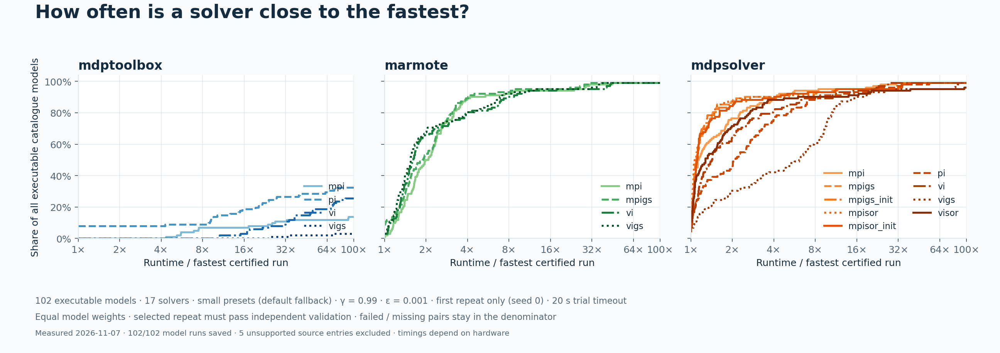

<h1 align="center">MDPForge</h1>

<p align="center"><strong>Finite Markov decision processes and reproducible solver benchmarks in Python.</strong></p>

<p align="center">
  <a href="https://github.com/OrsoF/mdpforge/actions/workflows/ci.yml"></a>
  <a href="https://github.com/OrsoF/mdpforge/actions/workflows/ci.yml"></a>
  <a href="https://github.com/OrsoF/mdpforge/blob/main/pyproject.toml"></a>
  <a href="https://github.com/OrsoF/mdpforge/blob/main/LICENSE"></a>
</p>

MDPForge helps researchers build finite Markov decision processes (MDPs), compare dynamic programming solvers, and record experiments that can be inspected and repeated. Use the same model interface for value iteration (VI), policy iteration (PI), modified policy iteration (MPI), and linear programming methods.

MDPForge brings together a model catalogue, interfaces to solver libraries, and experiment management. It already includes models from the Quantitative Verification Benchmark Set (QVBS) and adapters for MDPSolver and MDPToolbox. These projects supply model sources and solver implementations; MDPForge connects them through common inputs, timing, quality checks and saved experiment records.

- **Models:** catalogue recipes and custom sparse transition/reward matrices.
- **Solvers:** built-in methods and optional industrial backends behind one benchmark interface.
- **Quality checks:** explicit validation after timing, separate from execution status.
- **Experiment records:** paired trial seeds, solver settings, package versions, CSV results and JSON manifests.

Start with the [VI, PI and MPI demonstration](https://github.com/OrsoF/mdpforge/blob/main/notebooks/compare_vi_pi_mpi.ipynb): compare three small models, inspect accuracy certificates, plot runtimes and reopen the saved results.

<p align="center">
  <a href="#quick-start">Quick start</a> · <a href="#models-and-solvers">Models &amp; solvers</a> · <a href="#comparing-solution-quality">Solution quality</a> · <a href="#visualizations">Visualizations</a> · <a href="#examples-and-documentation">Documentation</a> · <a href="#contributing">Contributing</a>
</p>

## Quick start

### Install

Requires **Python 3.11+**. Install the built-in models, solvers and plotting:

```sh
python -m pip install "git+https://github.com/OrsoF/mdpforge.git"
```

From a checkout:

```sh
python -m pip install -e .
```

### Run a benchmark

```python
from mdpforge import Benchmark

bench = Benchmark()
bench.add_mdp("rooms")
bench.add_solver("mdpforge_vi")
bench.add_solver("mdpforge_mpi")

result = bench.run(discount=0.9, precision=1e-3, repeats=3, seed=0, validate=True)
result.export_csv("results.csv")
```

Runtime includes solver construction and execution. Pass `validate=True` to check solution quality after timing; execution success alone does not certify accuracy. CSV exports include a settings manifest; reopen them with `BenchmarkResult.from_csv(path)`.

```python
result.plot_performance_profile()
result.plot_heat(reference="mdpforge_vi")
```

`Benchmark()` uses discounted reward (`0 < discount < 1`). Use `criterion="total"` for finite total reward or `criterion="average"` for average reward with discounted models. The checks and their limits depend on this choice.

## Comparing solution quality

The requested `precision` is a target passed to each solver; solver libraries can use different stopping rules. `status="success"` means execution completed without an exception. A quality check is a separate step: with `validate=True`, `validation_status` records `passed`, `failed` or `not_run`, and `validation_method` names the requested check. The method name alone does not show that a check ran or passed.

| Reward criterion | What a passed check establishes | Limits |
| :--- | :--- | :--- |
| Discounted (`0 < discount < 1`) | A bound on the largest absolute value error across states, at most `precision`; the `policy` method also bounds the supplied policy's loss. | Residual, span, policy and bounds methods require the corresponding `SolveResult` fields. A certified bound is an upper limit, not a measured error against an exact solution. |
| Total | A value-error bound at most `precision` for absorbing models with no cycles among nonterminal states. | Requires declared terminal states that absorb with zero reward. Other finite-return models are outside the current certificate. |
| Average | A Bellman residual diagnostic at most `precision`: centered by the supplied gain, or its range when gain is absent. | This does **not** certify relative value error or policy quality; `error_bound` remains `NaN`, even when the diagnostic passes. |

The Bellman residual measures how much one optimality update changes the returned values. For discounted stochastic models, dividing its largest absolute component by `1 - discount` gives a value-error bound. See the [validation code](https://github.com/OrsoF/mdpforge/blob/main/src/mdpforge/core/validation.py) for all supported checks.

Validation runs after solver timing, in the parent process and outside the trial timeout. `validation_runtime` and `validation_error` are recorded separately; a failed check leaves execution status and runtime intact. Unavailable bounds remain `NaN`. Validation adds experiment time and can affect later cache and allocation behavior, so compare campaigns with the same recorded validation mode.

## Visualizations

### How often is a solver close to the fastest?



This snapshot was measured on **2026-11-07**: 102 catalogue recipes, 17 solvers from MDPToolbox, Marmote and MDPSolver, `discount=0.99`, `precision=1e-3`, seed 0, a 20-second trial timeout and `validate=True`. It uses the **first repeat only**, with small presets where available and default dimensions otherwise. It shows model-dependent performance on the recorded machine; one repeat cannot establish timing variability or current backend rankings.

At 2×, a curve shows the share of recipes solved within twice the fastest eligible runtime across all 17 solvers. The selected repeat must complete and pass validation; failed or missing pairs stay in the denominator. The panels share the same global baseline. These 102 recipes include related families and source variants, so they are not 102 independent problem families.

The [campaign manifest](https://github.com/OrsoF/mdpforge/blob/main/artifacts/results/backend_profiles_small_20261107/campaign.json) records model and solver selection, settings and exclusions. The [data directory](https://github.com/OrsoF/mdpforge/tree/main/artifacts/results/backend_profiles_small_20261107) contains each model's trial CSV and matching `.experiment.json` with dimensions, solver options, versions and machine information; [coverage.csv](https://github.com/OrsoF/mdpforge/blob/main/artifacts/results/backend_profiles_small_20261107/coverage.csv) contains the plotted summaries.

<details>
<summary>Replot the saved curves from a checkout</summary>

Run this example from the repository root with the notebook dependencies installed. It reads the saved summaries and preserves all recipes in the denominator; it does not rerun solvers. Colors and layout may differ from the image.

```python
import json
from pathlib import Path

import matplotlib.pyplot as plt
import numpy as np
import pandas as pd

source = Path("artifacts/results/backend_profiles_small_20261107")
campaign = json.loads((source / "campaign.json").read_text())
coverage = pd.read_csv(source / "coverage.csv")
times = coverage.pivot(
    index="catalogue_model", columns="solver", values="median_runtime"
).reindex(index=campaign["models"], columns=campaign["solvers"])
times = times.fillna(np.inf)
ratios = times.div(times.min(axis=1), axis=0).fillna(np.inf)

fig, axes = plt.subplots(1, 3, figsize=(15, 5), sharey=True)
for ax, backend in zip(axes, ["mdptoolbox", "marmote", "mdpsolver"]):
    for solver in ratios.columns:
        if solver.startswith(backend + "_"):
            values = ratios[solver].to_numpy()
            factors = np.unique(
                np.r_[1, values[np.isfinite(values) & (values <= 100)], 100]
            )
            shares = (values[:, None] <= factors).mean(axis=0)
            ax.step(factors, shares, where="post", label=solver)
    ax.set(xscale="log", xlim=(1, 100), ylim=(0, 1.04), title=backend)
    ax.set_xlabel("Runtime / fastest certified runtime")
    ax.legend(fontsize=7)
axes[0].set_ylabel("Share of all catalogue recipes")
plt.tight_layout()
plt.show()
```

</details>

## Models and solvers

`list_models()` and `list_solvers()` browse discounted catalogues. Other catalogues are `mdpforge.models.total`, `mdpforge.solvers.total` and `mdpforge.solvers.average`. Filter models by `size`/`category` and solvers by `family`/`backend`; use `ScalingBenchmark` for size sweeps.

`Benchmark()` starts empty. For discounted defaults, call `add_default_mdps()` for small Rooms, Mountain Car and Garnet, and `add_default_solvers()` for `mdpforge_vi` and `mdpforge_mpi`.

### Catalogue at a glance

The catalogue spans six task groups. The examples below are discounted recipes; the total-reward catalogue contains separate adaptations. T/S/M/L denote the `tiny`, `small`, `medium` and `large` presets available for each named example.

| Task group | Example families and recipes | Sources | Presets |
| :--- | :--- | :--- | :--- |
| Abstract | `garnet`, `chain_walk`; `jani_coupon_collector` | Local generators and published benchmarks; jani-models collection | T/S/M/L for Garnet and Chain Walk; T/S for Coupon Collector |
| Navigation and control | `rooms`, `mountain` | Local implementations of Rooms and Mountain Car | T/S/M/L |
| Distributed systems | `qvbs_csma`, `prism_rabin` | QVBS JANI sources; PRISM sources | T/S/M/L for CSMA; T/S/M for Rabin |
| Service operations | `access_control`, `qvbs_boxworld` | Sutton–Barto access control; QVBS logistics | T/S/M/L |
| Asset management | `inventory`, `forest`, `sysadmin` | Local implementations of published inventory, forest and network-management tasks | T/S/M/L |
| Games and puzzles | `peg_solitaire`, `pacman` | Local peg puzzle and reduced Pac-Man adaptation | T/S/M/L |

A problem family may have several recipes, source variants or reward objectives. A size preset selects parameters for a recipe; it is not another family, and several presets can select the same source instance. Requested state counts may be rounded or mapped to a bundled variant. Inspect actual `state_dim`, `action_dim` and transition nonzeros in the experiment manifest rather than treating preset names as fixed dimensions.

Browse the [discounted recipes](https://github.com/OrsoF/mdpforge/tree/main/src/mdpforge/models/discounted) and [total-reward recipes](https://github.com/OrsoF/mdpforge/tree/main/src/mdpforge/models/total). The [QVBS](https://github.com/OrsoF/mdpforge/blob/main/src/mdpforge/models/discounted/_qvbs/_data/model_manifest.json), [jani-models](https://github.com/OrsoF/mdpforge/blob/main/src/mdpforge/models/discounted/_jani/_data/model_manifest.json) and [PRISM](https://github.com/OrsoF/mdpforge/blob/main/src/mdpforge/models/discounted/_prism/_data/manifest.json) manifests record pinned sources and adaptations. Imported verification models use explicit discounted objectives; these do not reproduce every original verification property. Catalogue entries with `available=False` describe sources that still need an adaptation, and unavailable presets include a `reason`.

```python
from mdpforge import list_models

recipes = list_models(size="small", available=True)
for recipe in recipes:
    print(recipe["name"], recipe["category"], recipe["sizes"]["small"])
```

### Bring your own model

Provide one transition matrix per action and expected rewards of shape `(states, actions)`; dense and sparse inputs are accepted:

```python
bench.add_mdp(
    "my_mdp",
    transitions=[[[1, 0], [0, 1]], [[0, 1], [1, 0]]],
    reward=[[1, 0], [0, 2]],
)
```

### Bring your own solver

Register `bench.add_solver("my_solver", solve_function=my_solver)`. Discounted functions take `(transitions, rewards, discount, precision)`; total and average functions take `(model, precision)`. Return a NumPy value vector or `SolveResult`. The benchmark handles copies and timing; see the [solver guide](https://github.com/OrsoF/mdpforge/blob/main/docs/adding-a-solver.md) for class interfaces. Matrix-defined total models need `terminal_states` for validation.

### Optional backends

From a checkout, `python -m pip install ".[solvers]"` adds MDPax, MDPSolver, MDPToolbox, Pyomo/HiGHS, QuantEcon and CMA; `python -m pip install ".[models]"` adds mazelib. Versions are in [pyproject.toml](https://github.com/OrsoF/mdpforge/blob/main/pyproject.toml).

Install Marmote separately in the active Conda environment ([instructions](https://marmote.gitlabpages.inria.fr/marmote/instructions/linux/install_linux.html)):

```sh
conda install -c marmote -c conda-forge marmote
```

madupite requires a separate native installation with MPI/PETSc.

## Examples and documentation

To run the notebooks from a checkout, install their optional dependencies with `python -m pip install -e ".[notebooks]"`, then start `python -m jupyterlab`.

### A small, traceable campaign

Run [Compare VI, PI and MPI](https://github.com/OrsoF/mdpforge/blob/main/notebooks/compare_vi_pi_mpi.ipynb) cell by cell. It compares navigation, a chain and asset management using built-in solvers, with no optional solver backend. It is saved without results; its measurements are separate from the historical profile above.

| Setting | Notebook campaign |
| :--- | :--- |
| Models | Rooms, Chain Walk and Forest, each with 100 states; 4, 2 and 2 actions respectively |
| Solvers | `mdpforge_vi`, `mdpforge_pi`, `mdpforge_mpi`; MPI uses at most 10 policy-evaluation updates and `evaluation_precision=1e-3` |
| Target and repeats | Discounted reward, `discount=0.9`, `precision=1e-3`; 3 repeats with paired seeds 0, 1 and 2: 27 trials |
| Execution | `validate=True`, `timeout=None`, no warm-up trials; models built with `cache="off"` |
| Outputs | `artifacts/tmp/demo/<UTC timestamp>/vi_pi_mpi.csv` and `vi_pi_mpi.experiment.json`, relative to the notebook's working directory |

The notebook reports execution counts and passed certificates separately, plots runtime profiles and speedups, then reopens the CSV with `BenchmarkResult.from_csv()`. Keep both exported files together: the CSV records trials, while the JSON preserves model settings, solver options, seeds, validation mode, versions and machine details. Runtime includes solver construction, backend conversions and `run()`; model construction, copying and validation are outside timing. Timings depend on hardware and prior process state.

| Start here | What you will find |
| :--- | :--- |
| [Compare VI, PI and MPI](https://github.com/OrsoF/mdpforge/blob/main/notebooks/compare_vi_pi_mpi.ipynb) | Run a small comparison, inspect certificates and save reproducible results. |
| [Industrial backends](https://github.com/OrsoF/mdpforge/blob/main/notebooks/benchmark_industrial_solvers.ipynb) · [Scaling study](https://github.com/OrsoF/mdpforge/blob/main/notebooks/benchmark_scaling.ipynb) | Explore backend methods or runtime as model size grows. |
| [Benchmark API](https://github.com/OrsoF/mdpforge/blob/main/src/mdpforge/core/benchmark.py) · [Results API](https://github.com/OrsoF/mdpforge/blob/main/src/mdpforge/core/benchmark_result.py) · [Scaling API](https://github.com/OrsoF/mdpforge/blob/main/src/mdpforge/core/scaling_benchmark.py) | Inspect public interfaces and options. |
| [Cache and reproducibility](https://github.com/OrsoF/mdpforge/blob/main/docs/adding-a-model.md#3-reproducibility-and-caching) | Understand model identities, cache modes and reproducibility. |

## Contributing

Extend the catalogue by [adding a model](https://github.com/OrsoF/mdpforge/blob/main/docs/adding-a-model.md) or [adding a solver](https://github.com/OrsoF/mdpforge/blob/main/docs/adding-a-solver.md). See the [repository guidelines](https://github.com/OrsoF/mdpforge/blob/main/AGENTS.md) for the scientific contract and the [open questions](https://github.com/OrsoF/mdpforge/blob/main/docs/roadmap.md) for planned work.

Experimental: APIs and the catalogue may change. Project code uses the [MIT license](https://github.com/OrsoF/mdpforge/blob/main/LICENSE); bundled model sources retain their own licenses, listed in [package metadata](https://github.com/OrsoF/mdpforge/blob/main/pyproject.toml). Publication steps are in the [PyPI release guide](https://github.com/OrsoF/mdpforge/blob/main/docs/publishing.md).
