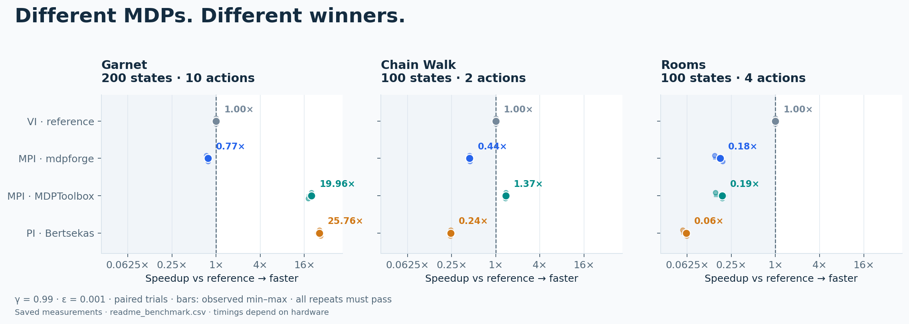
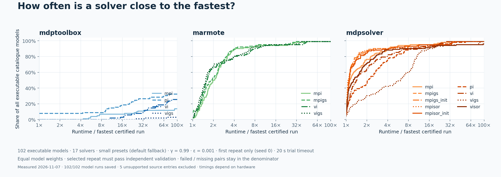
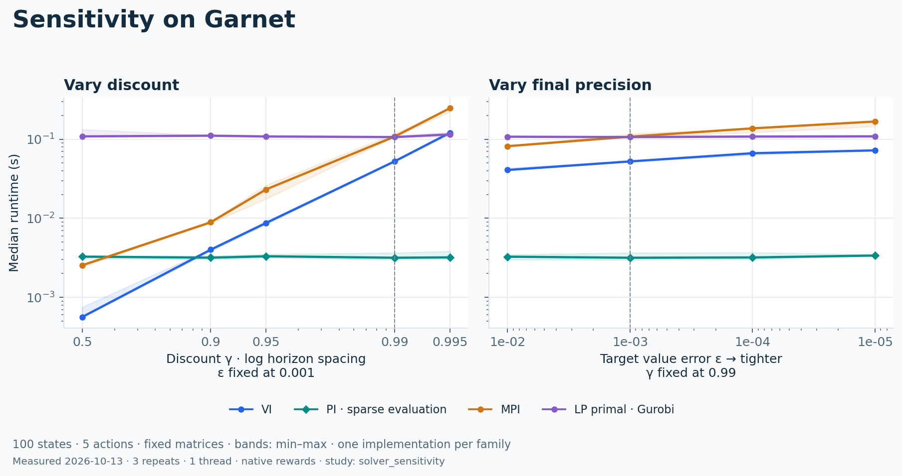

<h1 align="center">mdpforge</h1>

<p align="center"><strong>Benchmark finite MDPs and compare solvers.</strong></p>

<p align="center">
  <a href="https://github.com/OrsoF/mdpforge/actions/workflows/ci.yml"></a>
  <a href="https://github.com/OrsoF/mdpforge/actions/workflows/ci.yml"></a>
  <a href="pyproject.toml"></a>
  <a href="LICENSE"></a>
</p>

<p align="center">
  <a href="#quick-start">Quick start</a> · <a href="#models-and-solvers">Models &amp; solvers</a> · <a href="#visualizations">Visualizations</a> · <a href="#examples-and-documentation">Documentation</a> · <a href="#contributing">Contributing</a>
</p>



*Saved speedups at discount 0.99 and target value error 0.001; timings depend on hardware.*

## Quick start

### Install

Requires **Python 3.11+**. Install the built-in models, solvers and plotting:

```sh
python -m pip install "git+https://github.com/OrsoF/mdpforge.git"
```

From a checkout:

```sh
python -m pip install -e .
```

### Run a benchmark

```python
from mdpforge import Benchmark

bench = Benchmark()
bench.add_mdp("rooms")
bench.add_solver("mdpforge_vi")
bench.add_solver("mdpforge_mpi")

result = bench.run(discount=0.9, precision=1e-3, repeats=3, seed=0)
result.export_csv("results.csv")
```

Runtime includes solver construction and execution. Pass `validate=True` to check solution quality after timing; execution success alone does not certify accuracy. CSV exports include a settings manifest; reopen them with `BenchmarkResult.from_csv(path)`.

```python
result.plot_performance_profile()
result.plot_heat(reference="mdpforge_vi")
```

`Benchmark()` uses discounted reward (`0 < discount < 1`). Use `criterion="total"` for finite total reward or `criterion="average"` for average reward with discounted models. Total validation covers absorbing acyclic models; average validation is unavailable.

## Visualizations

### How often is a solver close to the fastest?



At 2×, a curve shows the share of models solved within twice the fastest eligible median runtime. Eligibility requires every repeat to succeed; all models remain in the denominator. The [gallery](notebooks/visualize_results.ipynb) explains these historical measurements; see the [export notes](docs/visualization-roadmap.md#interpreting-saved-results) before comparing current backends.

### How do discount and precision affect runtime?



The curves use one Garnet instance; bands show the range over three repeats.

## Models and solvers

`list_models()` and `list_solvers()` browse discounted catalogues. Other catalogues are `mdpforge.models.total`, `mdpforge.solvers.total` and `mdpforge.solvers.average`. Filter models by `size`/`category` and solvers by `family`/`backend`; use `ScalingBenchmark` for size sweeps.

`Benchmark()` starts empty. For discounted defaults, call `add_default_mdps()` for small Rooms, Mountain Car and Garnet, and `add_default_solvers()` for `mdpforge_vi` and `mdpforge_mpi`.

### Bring your own model

Provide one transition matrix per action and expected rewards of shape `(states, actions)`; dense and sparse inputs are accepted:

```python
bench.add_mdp(
    "my_mdp",
    transitions=[[[1, 0], [0, 1]], [[0, 1], [1, 0]]],
    reward=[[1, 0], [0, 2]],
)
```

### Bring your own solver

Register `bench.add_solver("my_solver", solve_function=my_solver)`. Discounted functions take `(transitions, rewards, discount, precision)`; total and average functions take `(model, precision)`. Return a NumPy value vector or `SolveResult`. The benchmark handles copies and timing; see the [solver guide](docs/adding-a-solver.md) for class interfaces. Matrix-defined total models need `terminal_states` for validation.

### Optional backends

From a checkout, `python -m pip install ".[solvers]"` adds MDPax, MDPSolver, MDPToolbox, Pyomo/HiGHS, QuantEcon and CMA; `python -m pip install ".[models]"` adds mazelib. Versions are in [pyproject.toml](pyproject.toml).

Install Marmote separately in the active Conda environment ([instructions](https://marmote.gitlabpages.inria.fr/marmote/instructions/linux/install_linux.html)):

```sh
conda install -c marmote -c conda-forge marmote
```

madupite requires a separate native installation with MPI/PETSc.

## Examples and documentation

| Start here | What you will find |
| :--- | :--- |
| [Benchmark API](src/mdpforge/core/benchmark.py) · [Results API](src/mdpforge/core/benchmark_result.py) · [Scaling API](src/mdpforge/core/scaling_benchmark.py) | Inspect public interfaces and options. |
| [Cache and reproducibility](docs/adding-a-model.md#3-reproducibility-and-caching) | Understand model identities, cache modes and reproducibility. |

## Contributing

Extend the catalogue by [adding a model](docs/adding-a-model.md) or [adding a solver](docs/adding-a-solver.md). See the [repository guidelines](AGENTS.md) for the scientific contract and the [open questions](docs/roadmap.md) for planned work.

Experimental: APIs and the catalogue may change. Released under the [MIT license](LICENSE).
