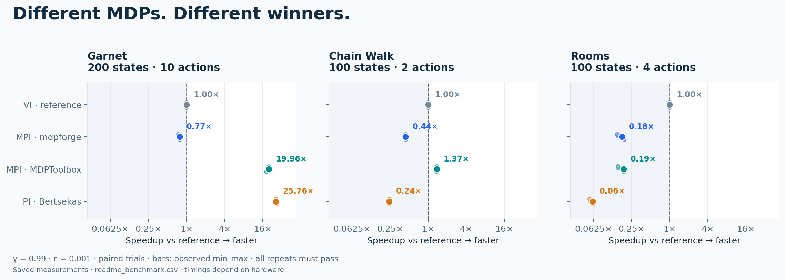
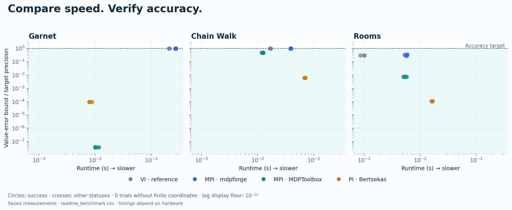
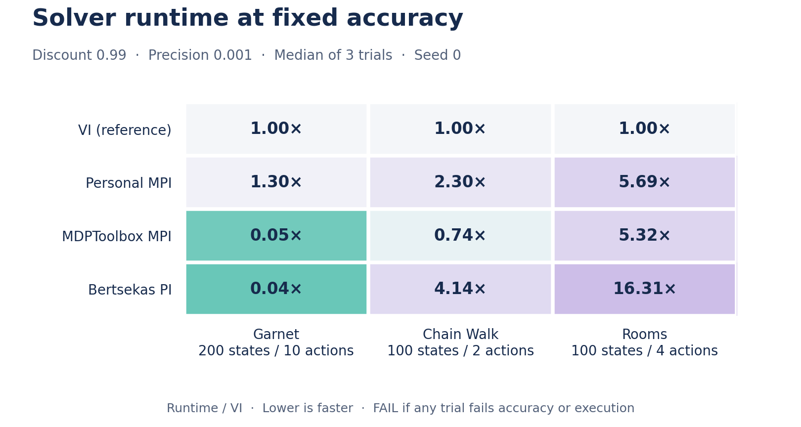
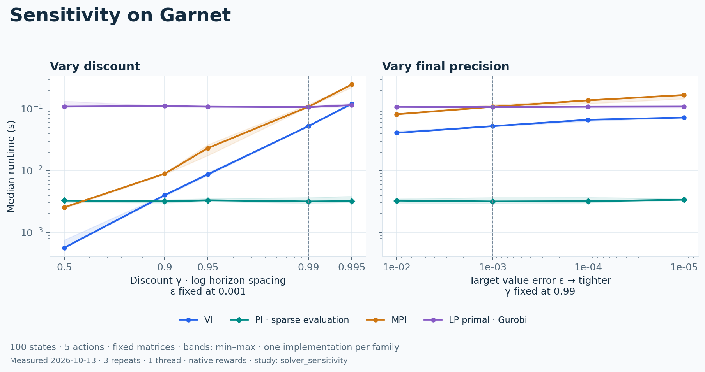

# mdpforge

**Benchmark your MDPs. Compare your solvers.**

A Python toolkit for comparing finite discounted MDP solvers at a shared target accuracy.

[](https://github.com/OrsoF/mdpforge/actions/workflows/ci.yml)
[](LICENSE)

Bring an MDP to challenge existing solvers, or bring a solver to challenge existing MDPs.

| Your starting point | Try it | Share it |
| --- | --- | --- |
| A new MDP | [Benchmark your transition and reward matrices](#define-an-mdp) against catalogue solvers | [Contribute a reproducible model recipe](docs/adding-a-model.md) |
| A new solver | [Register your solve function](#define-a-solver) and compare at a shared accuracy | Share the implementation, trial CSV and experiment manifest |



Compare runtime at the same target accuracy. Above 1× is faster than VI; large
points show median paired trial speedups and bars show the observed min–max.
Discount `0.99`, precision `1e-3`, three trials, seed `0`. These three small MDPs
illustrate different winners, not a universal ranking. Timings depend on hardware;
[trial results](artifacts/results/readme_benchmark.csv) ·
[reproduce the figures](notebooks/visualize_results.ipynb).

## Install

Python 3.11+. Install from GitHub:

```sh
python -m pip install "mdpforge @ git+https://github.com/OrsoF/mdpforge.git"
```

For plotting and MDPToolbox, use `"mdpforge[plot,mdptoolbox] @ git+https://github.com/OrsoF/mdpforge.git"`.
For local development: `python -m pip install -e .`. Other [extras](pyproject.toml)
include `mdpsolver`, `gurobi`, `marmote` and `maze`.

## Run a benchmark

```python
import numpy as np
from mdpforge import Benchmark

P = [[[1, 0], [0, 1]], [[0, 1], [1, 0]]]
R = [[1, 0], [0, 2]]


def my_solver(transitions, rewards, discount, precision):
    value = np.zeros(rewards.shape[0])
    while True:
        updated = np.max(
            [rewards[:, a] + discount * (p @ value) for a, p in enumerate(transitions)],
            axis=0,
        )
        if np.max(np.abs(updated - value)) <= precision * (1 - discount):
            return updated
        value = updated


bench = Benchmark(default_solvers=False)
bench.add_mdp("rooms")  # Existing MDP
bench.add_mdp("my_mdp", transitions=P, reward=R)  # New MDP
bench.add_solver("mdpforge_mpi")  # Existing solver
bench.add_solver("my_solver", solve_function=my_solver)  # New solver

result = bench.run(discount=0.9, precision=1e-3)
result.export_csv("results.csv")  # Also writes results.experiment.json
```

Each pair runs three trials. Results contain `runtime`, `error_bound` and `status`.

### Compare solvers

`Benchmark.run()` returns a `BenchmarkResult` that can be analyzed independently
of the benchmark, including after `BenchmarkResult.from_csv("results.csv")`.

```python
result.summary()                  # One row per MDP/solver; requires pandas
result.solver_summary(reference="mdpforge_mpi")  # Solver performance metrics
result.to_dataframe()             # Raw trials; requires pandas
result.plot_performance_profile() # Share of MDPs within a factor of the fastest
result.plot_heat(reference="mdpforge_mpi")
```

Install the `notebooks` extra for pandas (or install pandas separately); plots
require the `plot` extra. A pair contributes a median runtime only when all
expected trials succeeded with positive, finite runtimes. Expected repeats come
from the experiment manifest, or from observed repeat IDs when it is absent.
Missing or failed pairs count as unsolved in `solver_summary()` and performance
profiles. `n_failed` counts such MDPs, not failed individual trials.
`success_rate`, `fastest_rate` and `within_2x` use all MDPs in the run
as denominator; `median_ratio` and `median_runtime` include only completed MDPs.
`geomean_speedup` is the geometric mean of reference/solver median-runtime
ratios on MDPs completed by **both** solvers; `n_compared` reports that sample
size (0 yields NaN). Set `reference` explicitly when comparing runs; omitting
it uses the first solver in the measurements.
Performance profiles use equal model weights and compare against the fastest
eligible median on each MDP. Their reference changes when the solver set changes.

Each run has an `experiment_id`; its manifest records model configurations and
matrix fingerprints, solver options/defaults, versions, machine details and Git
provenance. Metadata is captured before timing. Model generation seeds are separate
from trial seeds; fingerprints identify the actual data, without storing matrices.
`Benchmark()` includes VI by default; use `verbose=True` to show progress.
[Explore the notebook](notebooks/benchmark.ipynb) for catalogue comparisons and plots.

Reuse a benchmark with `reset()`; it returns the same object for chaining:

```python
bench.reset()  # Clear MDPs; restore initial solver defaults
bench.reset(models=False)  # Keep MDPs; restore initial solver defaults
bench.reset(solvers=False)  # Clear MDPs; keep solvers and their options
bench.reset(models=False, solvers=False)  # Keep both models and solvers
```

Previously returned `BenchmarkResult` objects are independent of `Benchmark`
and remain available after reset. Resetting solvers restores VI alone for
`Benchmark()`, or no solvers for `Benchmark(default_solvers=False)`.
Cached models and exported files are preserved.

## Explore the results

[Open the visual gallery](notebooks/visualize_results.ipynb) to plot existing CSVs
without running a benchmark. It exports PNG and SVG figures and explains how each
view handles failed trials.

| View | What it answers |
| --- | --- |
| Speedup with repeat spread | On which MDPs does my solver beat the reference? |
| Performance profile | On what fraction of models is it within 2× of the fastest? |
| Outcome breakdown | How many models pass every repeat, and where do trials fail? |
| Runtime vs value-error bound | Do faster runs still meet the requested accuracy? |



The dashed line is the accuracy target. Every point below it meets the requested
value-error bound; that bound is not the unknown actual error. This uses the same
saved trials as the speedup figure. The gallery's larger backend example is a
**historical export with MDPSolver 0.10.1**, before the VISOR fix; rerun
[the backend notebook](notebooks/benchmark_backends.ipynb) for current results.

<details>
<summary>See the original runtime heatmap</summary>



This saved heatmap shows median runtime / median VI runtime: lower is faster.
Its ratio of medians differs from the median of paired trial speedups above.
For a new run, use `result.plot_heat(reference="VI")`; the current API displays
speedup (higher is faster) by default and marks any failed repeat as `FAIL`.

</details>

See the [visualization roadmap](docs/visualization-roadmap.md) for suggested next
experiments and contribution examples.

## Study method, discount and precision

[The sensitivity notebook](notebooks/solver_sensitivity.ipynb) compares eight
implementations from four families: VI-like, PI, MPI-like and linear programming.
It then varies discount at fixed precision, and precision at fixed discount,
reusing the exact same matrices, native rewards and paired trial seeds.



This illustration selects plain VI, PI, MPI and primal LP on one Garnet instance;
the notebook retains all eight implementations and all three MDPs. The saved
study contains 576 trials, three repeats per setting, with one thread. Every trial
passed the independent Bellman-residual value-error check. The plots show medians
and observed min–max spread, not confidence intervals or a universal family ranking.

PI's sparse policy evaluation and the LP wrappers do not use `final_precision`
as an iterative stopping tolerance; their achieved bounds can be much tighter
than requested. Inspect the notebook's achieved-bound and failure tables when
interpreting flat precision curves. Set `FULL_GRID=True` in a **new study** to
investigate discount × precision interactions; the demo varies one factor at a time.

[Raw trials and experiment manifests](artifacts/results/solver_sensitivity/study.json) ·
[all methods at the shared accuracy target](artifacts/figures/sensitivity_methods.png) ·
[all discount and precision sweeps](artifacts/figures/sensitivity_sweeps.png)

## Limit each trial's runtime

Use `bench.run(discount=0.9, timeout=60)` to limit each trial to 60 seconds in
a dedicated process. The deadline includes child startup, model copying, solver
construction/execution and result transfer; parent input serialization and final
accuracy checks are outside it. A blocked trial gets `status="timeout"`, and the
remaining trials continue. Timed-out or crashed trials have `runtime=NaN`;
completed trials measure solver time without process startup or transfers.

The default `timeout=None` runs in the current process. With a timeout, use
importable solver functions/classes and pickleable models/options. In scripts,
put benchmark execution under `if __name__ == "__main__":`; in notebooks, import
custom solvers from a Python module. Cleanup may take up to two extra seconds
and terminates the worker only, not subprocesses launched by a custom solver.

## Define an MDP

For a new catalogue recipe, follow the
[model contribution requirements](docs/adding-a-model.md): scientific definition,
construction interface, metadata, size presets, reproducibility and validation.

- `transitions[action]`: an `(S, S)` matrix, dense or sparse.
- `reward[state, action]`: expected immediate rewards, shape `(S, A)`.

Dimensions, CSR conversion and validation are automatic. Use unique names;
select [catalogue models](src/mdpforge/models) by module name.
Use `from mdpforge import list_models`, then `list_models(category="navigation")`
to browse descriptions and declared references without building models.
Each recipe exposes a literal `METADATA` dict with `category`, `description`,
`reference` and `sizes`. Each recipe declares exactly one task category:

| Category | Task family |
|---|---|
| `abstract` | Abstract chains or generated MDPs for algorithm studies |
| `navigation` | Movement through spatial environments, routes or racetracks |
| `physical_control` | Physical systems with dynamical equations |
| `service_operations` | Admission, assignment and service of requests or passengers |
| `asset_management` | Use, allocation, maintenance or renewal of stocks and assets |
| `games_and_puzzles` | Games, betting and symbolic puzzles |

These categories describe tasks, not expected solver performance. Classification
rules and boundary cases are documented in [the model guide](docs/adding-a-model.md).
Each size preset contains its expected actual
`state_dim`, constructor `parameters`, and `source` (`measured`, `inferred`,
`configured`, `analytical`, `parameterized` or `unavailable`). Configured,
analytical and parameterized sizes describe dimension choices without measured
solver runtimes. Constructor inputs can differ from the resulting dimensions.
Unavailable presets have `parameters=None` and a reason. A missing or unknown
category raises `ValueError`; missing sizes default to an empty dict and other
optional fields to `None`.

```python
from mdpforge import Benchmark, list_models

presets = list_models(size="small", category="abstract")  # Metadata only
bench = Benchmark()
bench.add_mdp(size="small", category="abstract")
```

`bench.add_mdp(size=..., category=...)` builds and registers matching models using
`create_model()` and the existing matrix cache. Either filter can be used alone;
combining them selects their intersection. Already-registered model names are
skipped before building or loading their matrices, preserving existing instances.
Filters can constrain a catalogue name; built objects and custom matrices cannot
be combined with filters. For example, `bench.add_mdp("block", size="small")`
uses Block's small preset, and an optional `category` must match the named recipe.
A nonempty list or tuple selects multiple catalogue models in the given order:
`bench.add_mdp(model=["block", "garnet", "unichain"], size="small")`.
Without `size`, each recipe uses its defaults. Repeated names and existing
instances are skipped. All explicit names must exist and match the filters;
invalid selections fail before adding any models. Missing dependencies are
skipped with warnings for sequences, as for other collective additions.
A named model with an unavailable size raises `ValueError` without falling back
to its defaults. Without a model, at least one filter is required;
use `bench.add_all_models()` to add the entire catalogue with defaults.

`size` accepts `small`, `medium` or `large`; omitted size uses constructor defaults.
`category` selects exactly one of the six task families; omitted category selects
all families. Unknown size/category labels raise `ValueError`. Both APIs use
`category=`; the former `type=` keyword has been removed.
Unavailable presets are excluded. Collective additions (filters or
`add_all_models()`) skip models with missing dependencies with a warning;
other construction errors propagate. Adding a single model by name propagates all errors.
For use outside a benchmark, construct the recipe directly, for example
`from mdpforge.models.rooms import Model`, followed by `model = Model()` and
`model.create_model(save=False)` to avoid writing newly built matrices (existing
caches are read). The catalogue `load_model()` API has been removed; use
`bench.add_mdp(size=..., category=...)` for benchmark selections.

Calibrated presets use measurements at discount `0.99`, precision `1e-3`
and one thread. Inferred large presets aim at a 30-second solver budget with a
15-second forecast margin. These timings are hardware dependent and do not cover
failed backends or algorithms other than the measured VI variants. The existing
`utils.persistence.load_model(model)` remains the internal cache loader.

Check current presets from the repository root:

```text
conda run -n benchmark python check_model_sizes.py --dimensions-only
conda run -n benchmark python check_model_sizes.py --sizes large
```

The first command checks constructor dimensions for all three sizes without
building matrices. The second validates large matrices and measures the four
calibration solvers, sequentially, with an independent Bellman residual check.
Use `--build-only` to validate matrices without running solvers, or `--models`
to select recipes. Each stage runs in a subprocess with a 60-second timeout by
default. Results append to `artifacts/results/model_size_<mode>.csv`; reruns resume
completed cases. The modes are `dimensions`, `build` and `runtimes`.
Changed model source or settings create new cases. Use a different `--output` to
repeat unchanged cases, including after modifying a solver: backend source changes
do not invalidate completed cases. A nonzero exit code reports unavailable/failed presets
or successful solves above the 1 / 5 / 30 second size budget.
These commands read current `METADATA`, including configured presets; the older
`inferred_environment_sizes.json` is a historical calibration snapshot.

`MDP.get_config()` captures public parameters; override it for a custom configuration.
Objects that cannot be serialized are identified by type in the manifest.

## Define a solver

`solve_function(transitions, rewards, discount, precision)` returns a NumPy value
vector of length `S`. Inputs are CSR transitions and NumPy rewards; the benchmark
handles copies, timing and final accuracy checks.

Without `solve_function`, the name selects a [catalogue solver](src/mdpforge/solvers).
Custom names must be unique; extra keyword options are forwarded to the solver.

Each catalogue solver module declares a literal `METADATA` dict with
`display_name`, `family`, `backend`, `description` and `update_scheme`.
Families are `vi`, `pi`, `mpi` and `lp`; backends identify the implementation
library. Update schemes are `synchronous`, `gauss_seidel`, `sor`, `linear_solve`,
`mixed` and `not_applicable`. `linear_solve` denotes matrix-based policy evaluation;
`mixed` combines Bellman sweeps with aggregate linear corrections or stochastic
updates; LP uses `not_applicable` because it has no Bellman sweep scheme.
Metadata describes the default implementation; initialization variants are
identified in the display name and description. Existing constructor options
and experiment manifests still describe the configuration of each actual run.

Browse and select solvers by these characteristics:

```python
from mdpforge import Benchmark, list_solvers

entries = list_solvers(family=["pi", "mpi"], backend="mdpforge")
print([entry["display_name"] for entry in entries])  # No backend imports

bench = Benchmark(default_solvers=False)
bench.add_solver(family="vi", backend="mdpforge")
bench.add_solver(family=["pi", "mpi"], backend="mdpforge")

# Register existing Gauss-Seidel and SOR variants, without reconfiguring VI.
bench.add_solver(family="vi", update_scheme=["gauss_seidel", "sor"])
```

Filters combine fields with AND and values within a list with OR. Unknown
values and combinations matching no catalogue solver raise `ValueError`.
`list_solvers()` returns the technical `name` and all five metadata fields,
including backends that are not installed. Solver modules without metadata
remain discoverable, with their filename as display name and other fields `None`.
Both listing and selection use a string or a nonempty sequence for each filter.

Group additions skip missing dependencies with warnings, preserve matching
registrations and avoid duplicating the default VI. A conflicting implementation
or explicit option configuration under the same name raises `ValueError`.
Constructor options apply to every selected solver; unsupported option names
are rejected before any group registrations change. For example,
`bench.add_solver(family="vi", backend="mdpsolver", update_scheme="synchronous", parallel=True)`
selects only MDPSolver's standard-update VI implementation and forwards `parallel`.
Options are compared as supplied; omitted defaults and explicitly supplied
defaults are distinct configurations.

Named calls such as `bench.add_solver("mdpsolver_vi", parallel=True)` retain their
existing behavior. A named catalogue solver may also be constrained by filters;
an incompatible filter raises an error rather than switching its algorithm.
Filters cannot accompany `solve_function`. `bench.add_all_solvers()` still adds
the entire catalogue with defaults, and `bench.add_solver()` without a name or
filter remains invalid.

Each experiment manifest snapshots solver metadata alongside constructor options.
CSV solver IDs stay unchanged. Display names use `Method · Backend · Variant`,
for example `MPI · MDPSolver · GS · V₀=0` or `LP · Gurobi · dual`. Standard
updates have no suffix. GS means Gauss-Seidel, SOR means successive over-relaxation,
and `V₀=0` denotes zero initialization; plots explain the abbreviations they use.
Distinct methods retain their names, such as `Aggregated VI` and `Envelope VI`.
`reward init` denotes initialization from rewards; `eval budget` denotes the
policy-evaluation budget variant. QVI denotes Q-value iteration.

`result.plot_heat()` uses recorded display names, adding IDs when labels collide,
and sorts rows by family (VI, PI, MPI, LP), method, backend and variant. Custom
callables without family metadata follow in registration order. Its `reference`
argument always uses the registered ID; the default remains the first registered
solver. Existing experiment manifests retain the names recorded at run time;
new runs capture the updated names.

## Limitations

Experimental: APIs and the catalogue may change. Only finite discounted MDPs
(`0 < discount < 1`) are supported. Final value accuracy is checked independently;
compare runs with `status="success"`. External solvers require their optional
dependencies. The MDPSolver integration requires version 0.10.2 or later.

[MIT license](LICENSE).
